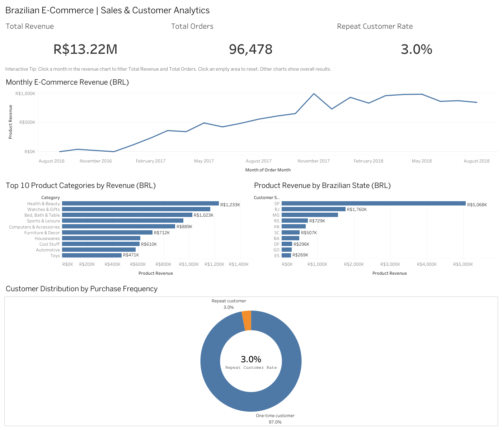

# End-to-End E-Commerce Analytics Platform

An end-to-end data engineering and business intelligence project that transforms raw Brazilian e-commerce data into actionable business insights using **Python, Snowflake, SQL, dbt, and Tableau**.

The project demonstrates the complete analytics workflow, from data ingestion and warehouse modeling to automated data quality testing and interactive dashboard development.

## Project Overview

This project analyzes the **Olist Brazilian E-Commerce Public Dataset**, containing approximately 100,000 orders and information about customers, products, sellers, payments, and shipping.

The goal is to build a reliable analytics pipeline that answers important business questions:

- How does revenue change over time?
- Which product categories generate the most revenue?
- Which Brazilian states contribute the most sales?
- How frequently do customers make repeat purchases?
- How can raw transactional data be transformed into reliable reporting datasets?

## Technology Stack

| Technology | Purpose |
|---|---|
| Python | Data ingestion and processing |
| Pandas | Data cleaning and manipulation |
| Snowflake | Cloud data warehouse |
| SQL | Data transformations and analysis |
| dbt | Data modeling and automated testing |
| Tableau Public | Interactive dashboards |
| Git & GitHub | Version control and project documentation |

## Data Pipeline Architecture

```text
Olist E-Commerce Dataset
          |
          v
   Raw CSV Files
          |
          v
   Python + Pandas
          |
          v
 Snowflake RAW Schema
          |
          v
    dbt Staging Models
          |
          v
 dbt Analytics Models
          |
          v
 Snowflake DBT_DEV Schema
          |
          v
   Analytics CSV Exports
          |
          v
    Tableau Dashboard
```

The pipeline follows a layered architecture.

**Data ingestion:** Python and Pandas load the original CSV datasets into Snowflake.

**Data transformation:** dbt organizes the raw data into staging models, dimensional tables, fact tables, and business reporting models.

**Data validation:** Automated dbt tests check the reliability of the transformed data.

**Visualization:** Validated reporting datasets are exported to CSV and connected to Tableau Public to create an interactive dashboard.

## Dataset

**Source:** Olist Brazilian E-Commerce Public Dataset

The dataset includes nine source tables:

1. Customers
2. Orders
3. Order Items
4. Products
5. Payments
6. Order Reviews
7. Sellers
8. Product Category Translation
9. Geolocation

The source data includes **99,441 orders** and **112,650 order items**.

For sales reporting, the project focuses on delivered orders.

## Snowflake Data Warehouse

Snowflake serves as the cloud data warehouse for this project, storing the original e-commerce datasets and the transformed analytics tables.

**Warehouse architecture:**

- **Database:** `ECOMMERCE_DB`
- **Raw schema:** `RAW` — stores source datasets loaded using Python and Pandas
- **Analytics schema:** `DBT_DEV` — stores transformed dbt models
- **Compute warehouse:** `COMPUTE_WH`

**SQL transformations in Snowflake:**

The project uses dbt to execute SQL transformations directly within Snowflake. These transformations include:

- Cleaning and standardizing source records
- Joining transactional, customer, product, and seller data
- Building dimensional and fact tables
- Calculating monthly revenue and category performance
- Analyzing customer purchasing behavior and geographic sales

**Explore the SQL code:**

- [Staging SQL Models](ecommerce_dbt/models/staging/)
- [Analytics SQL Models](ecommerce_dbt/models/marts/)
- [SQL Data Quality Tests](ecommerce_dbt/tests/)

The dbt pipeline successfully built 16 models and passed 60 automated tests.

## Data Modeling

The dbt project contains **16 models**, organized into staging and analytics layers.

### Staging Layer

Six staging models prepare and standardize raw source data for downstream transformations.

### Dimensional Models

- `dim_customers`
- `dim_products`
- `dim_sellers`
- `dim_date`

### Fact Model

- `fact_order_items`

### Business Analytics Models

- `monthly_sales`
- `category_sales`
- `customer_metrics`
- `seller_metrics`
- `state_sales`

These models support reporting across revenue, customers, products, sellers, and geographic regions.

## Data Quality Testing

The project uses automated dbt tests to validate the transformation pipeline.

**Final dbt build results:**

- 16 models successfully built
- 60 automated tests passed
- 0 errors
- 0 warnings

This helps ensure that dashboard metrics are based on consistently transformed and validated data.

## Tableau Dashboard

### Dashboard Preview



**Dashboard:** Brazilian E-Commerce | Sales & Customer Analytics

The interactive dashboard includes:

### Key Performance Indicators

| Metric | Result |
|---|---:|
| Product Revenue | R$13.22M |
| Delivered Orders | 96,478 |
| Repeat Customer Rate | 3.0% |

### Visualizations

**Monthly Revenue Trend**

Tracks product revenue over time and allows users to select a month to update the revenue and order KPIs.

**Top 10 Product Categories**

Ranks product categories by product revenue, with detailed tooltips showing revenue, orders, and items sold.

**Revenue by Brazilian State**

Highlights the highest-revenue states, with tooltips showing revenue, orders, customers, and items sold.

**Customer Purchasing Behavior**

Visualizes the distribution of one-time and repeat customers.

The dashboard uses Brazilian reais (BRL). Product revenue excludes shipping charges.

## Key Business Insights

### Revenue Performance

The delivered-order dataset generated approximately **R$13.22 million in product revenue**.

November 2017 generated approximately **R$988,765** in product revenue across **7,289 delivered orders**.

### Top Product Categories

The highest-revenue categories included:

| Category | Product Revenue |
|---|---:|
| Health & Beauty | R$1,233,131.72 |
| Watches & Gifts | R$1,166,176.98 |
| Bed, Bath & Table | R$1,023,434.76 |
| Sports & Leisure | R$954,852.55 |
| Computers & Accessories | R$888,724.61 |

### Geographic Performance

The highest-revenue Brazilian states included:

| State | Product Revenue |
|---|---:|
| São Paulo (SP) | R$5,067,633.16 |
| Rio de Janeiro (RJ) | R$1,759,651.13 |
| Minas Gerais (MG) | R$1,552,481.83 |

### Customer Retention

Approximately **3.0% of customers** in the delivered-order analysis made repeat purchases.

This highlights customer retention as an important area for further business investigation.

## Project Structure

```text
ecommerce-analytics-platform/
|
|-- data/
|-- etl/
|-- ecommerce_dbt/
|-- logs/
|-- notebooks/
|-- sql/
|-- tableau/
|-- tableau_data/
|-- README.md
|-- requirements.txt
|-- .gitignore
```

## Future Improvements

Potential extensions include:

- Automating recurring data ingestion and transformation
- Adding incremental dbt models
- Building seller performance and customer cohort dashboards
- Adding customer retention and revenue forecasting analyses
- Deploying a scheduled end-to-end analytics workflow

## Project Purpose

This project was developed as a hands-on portfolio demonstration of skills in:

- Data engineering and ETL pipelines
- Cloud data warehousing
- SQL-based data transformation
- Dimensional data modeling
- Automated data quality testing
- Business intelligence and dashboard development
- End-to-end analytics system design

## Data Attribution

Dataset: **Olist Brazilian E-Commerce Public Dataset**

Available on Kaggle: https://www.kaggle.com/datasets/olistbr/brazilian-ecommerce